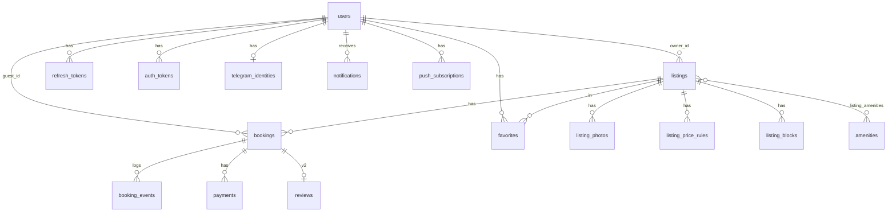

# DB: схема базы данных StayNest

PostgreSQL 16. Источник правды: SQL-миграции в `db/migrations` (node-pg-migrate). Этот файл должен совпадать с миграциями, при изменении схемы агент обновляет его в той же сессии.

Принципы: PK `uuid` (`gen_random_uuid()`), время `timestamptz`, даты проживания `date`/`daterange` с границами `[)`, деньги `bigint` в копейках + `currency char(3)`, мягкое удаление только у `users`.

## Миграции

Файлы в `db/migrations` применяются по порядку номеров, каждая миграция имеет `up` и `down`:

| Файл | Содержимое |
|---|---|
| `0001_extensions_and_types` | расширения `btree_gist`, `citext`, `pg_trgm`, перечисления, `set_updated_at()` |
| `0002_users_and_tokens` | `users`, `refresh_tokens`, `auth_tokens` |
| `0003_amenities` | справочник удобств + идемпотентный сид 14 записей |
| `0004_listings` | `listings`, `listing_amenities`, `listing_photos`, внешний ключ обложки |
| `0005_bookings_and_audit` | `bookings` с EXCLUDE, `booking_events`, `idempotency_keys` |
| `0006_availability_and_misc` | блокировки и цены, Telegram, избранное, уведомления, push, платежи, отзывы |
| `0007_listing_drafts` | незаполненные черновики объявлений: nullable-поля и CHECK полноты для `published`/`archived` |

```bash
pnpm db:reset        # пересоздать базу разработки: drop schema, миграции, сид
pnpm db:reset:test   # то же для базы интеграционных тестов
pnpm db:migrate      # применить недостающие миграции
pnpm db:migrate:down # откатить все миграции
pnpm db:codegen      # пересобрать типы Kysely в apps/api/src/platform/db/schema.generated.ts
```

Служебная таблица `pgmigrations` создаётся node-pg-migrate и в доменную схему не входит.

## ER-диаграмма



## 0. Расширения, типы, общие функции

```sql
CREATE EXTENSION IF NOT EXISTS btree_gist;  -- для EXCLUDE по (uuid, daterange)
CREATE EXTENSION IF NOT EXISTS citext;      -- email без учёта регистра
CREATE EXTENSION IF NOT EXISTS pg_trgm;     -- нечёткий поиск по городу

CREATE TYPE listing_type   AS ENUM ('house', 'cottage', 'cabin', 'villa', 'townhouse');
CREATE TYPE listing_status AS ENUM ('draft', 'published', 'archived');
CREATE TYPE booking_status AS ENUM (
  'pending', 'confirmed', 'declined',
  'cancelled_by_guest', 'cancelled_by_host', 'expired', 'completed'
);

CREATE OR REPLACE FUNCTION set_updated_at() RETURNS trigger AS $$
BEGIN
  NEW.updated_at = now();
  RETURN NEW;
END;
$$ LANGUAGE plpgsql;
```

## 1. users — пользователи

| Столбец | Тип | Ограничения / примечания |
|---|---|---|
| id | uuid | PK, default gen_random_uuid() |
| email | citext | NOT NULL, UNIQUE |
| password_hash | text | NULL допустим (вход только через Telegram, Сессия 19). Argon2id |
| display_name | text | NOT NULL, длина 1–80 |
| phone | text | NULL |
| avatar_key | text | NULL, ключ в MinIO |
| locale | text | NOT NULL, default 'ru', CHECK IN ('ru','en') |
| is_active | boolean | NOT NULL, default true |
| email_verified_at | timestamptz | NULL, момент подтверждения email (NULL = не подтверждён) |
| created_at | timestamptz | NOT NULL, default now() |
| updated_at | timestamptz | NOT NULL, default now(), триггер set_updated_at |
| deleted_at | timestamptz | NULL, мягкое удаление |

```sql
CREATE TABLE users (
  id            uuid PRIMARY KEY DEFAULT gen_random_uuid(),
  email         citext NOT NULL UNIQUE,
  password_hash text,
  display_name  text NOT NULL CHECK (char_length(display_name) BETWEEN 1 AND 80),
  phone         text,
  avatar_key    text,
  locale        text NOT NULL DEFAULT 'ru' CHECK (locale IN ('ru','en')),
  is_active     boolean NOT NULL DEFAULT true,
  email_verified_at timestamptz,
  created_at    timestamptz NOT NULL DEFAULT now(),
  updated_at    timestamptz NOT NULL DEFAULT now(),
  deleted_at    timestamptz
);
CREATE TRIGGER users_set_updated_at BEFORE UPDATE ON users
  FOR EACH ROW EXECUTE FUNCTION set_updated_at();
```

## 2. refresh_tokens — сессии

| Столбец | Тип | Примечания |
|---|---|---|
| id | uuid | PK |
| user_id | uuid | FK users(id) ON DELETE CASCADE, NOT NULL |
| token_hash | text | NOT NULL, UNIQUE (хранится SHA-256, не сам токен) |
| family_id | uuid | NOT NULL, группа ротации (для отзыва всей цепочки при повторном использовании) |
| user_agent | text | NULL |
| ip | inet | NULL |
| expires_at | timestamptz | NOT NULL |
| revoked_at | timestamptz | NULL |
| created_at | timestamptz | NOT NULL, default now() |

```sql
CREATE TABLE refresh_tokens (
  id          uuid PRIMARY KEY DEFAULT gen_random_uuid(),
  user_id     uuid NOT NULL REFERENCES users(id) ON DELETE CASCADE,
  token_hash  text NOT NULL UNIQUE,
  family_id   uuid NOT NULL,
  user_agent  text,
  ip          inet,
  expires_at  timestamptz NOT NULL,
  revoked_at  timestamptz,
  created_at  timestamptz NOT NULL DEFAULT now()
);
CREATE INDEX refresh_tokens_user_idx ON refresh_tokens (user_id);
CREATE INDEX refresh_tokens_family_idx ON refresh_tokens (family_id);
```

## 2b. auth_tokens — одноразовые токены (подтверждение email, сброс пароля)

В БД хранится только хэш токена (SHA-256). Токен одноразовый: после использования ставится `used_at`.

| Столбец | Тип | Примечания |
|---|---|---|
| id | uuid | PK |
| user_id | uuid | FK users(id) ON DELETE CASCADE, NOT NULL |
| kind | text | NOT NULL, CHECK IN ('verify_email', 'reset_password') |
| token_hash | text | NOT NULL, UNIQUE |
| expires_at | timestamptz | NOT NULL (verify_email 24 часа, reset_password 1 час) |
| used_at | timestamptz | NULL |
| created_at | timestamptz | NOT NULL, default now() |

```sql
CREATE TABLE auth_tokens (
  id         uuid PRIMARY KEY DEFAULT gen_random_uuid(),
  user_id    uuid NOT NULL REFERENCES users(id) ON DELETE CASCADE,
  kind       text NOT NULL CHECK (kind IN ('verify_email', 'reset_password')),
  token_hash text NOT NULL UNIQUE,
  expires_at timestamptz NOT NULL,
  used_at    timestamptz,
  created_at timestamptz NOT NULL DEFAULT now()
);
CREATE INDEX auth_tokens_user_kind_idx ON auth_tokens (user_id, kind);
```

## 3. telegram_identities — привязка Telegram (Сессия 19)

```sql
CREATE TABLE telegram_identities (
  user_id     uuid PRIMARY KEY REFERENCES users(id) ON DELETE CASCADE,
  telegram_id bigint NOT NULL UNIQUE,
  username    text,
  created_at  timestamptz NOT NULL DEFAULT now()
);
```

## 4. amenities — справочник удобств

| Столбец | Тип | Примечания |
|---|---|---|
| id | smallint | PK, identity |
| code | text | NOT NULL, UNIQUE (`wifi`, `sauna`, `parking`, `fireplace`, `pets_allowed`, `pool`, `bbq`, `kitchen`, `washer`, `ac`, `tv`, `kids_friendly`, `lake_view`, `mountain_view`) |
| name_ru | text | NOT NULL |
| name_en | text | NOT NULL |
| icon | text | NOT NULL, имя иконки |
| sort_order | smallint | NOT NULL, default 0 |

```sql
CREATE TABLE amenities (
  id         smallint GENERATED ALWAYS AS IDENTITY PRIMARY KEY,
  code       text NOT NULL UNIQUE,
  name_ru    text NOT NULL,
  name_en    text NOT NULL,
  icon       text NOT NULL,
  sort_order smallint NOT NULL DEFAULT 0
);
```

## 5. listings — объявления

| Столбец | Тип | Ограничения / примечания |
|---|---|---|
| id | uuid | PK |
| owner_id | uuid | FK users(id), NOT NULL |
| status | listing_status | NOT NULL, default 'draft' |
| type | listing_type | NOT NULL, default 'house' |
| title | text | NULL только у черновика, для `published`/`archived` 5–120 символов |
| description | text | NOT NULL, default '' |
| country | text | NOT NULL, default 'RU' (ISO код) |
| region | text | NULL |
| city | text | NULL только у черновика |
| address_line | text | NULL (в публичной выдаче скрывается до подтверждения брони) |
| lat, lng | numeric(9,6) | NULL, CHECK диапазонов |
| max_guests | smallint | NULL только у черновика, 1–30 |
| bedrooms | smallint | NULL только у черновика, 0–20 |
| beds | smallint | NULL только у черновика, 1–40 |
| bathrooms | smallint | NOT NULL, default 1 |
| area_sqm | smallint | NULL |
| base_price_minor | bigint | NULL только у черновика, CHECK > 0, цена за ночь |
| weekend_price_minor | bigint | NULL, CHECK > 0 |
| cleaning_fee_minor | bigint | NOT NULL, default 0, CHECK >= 0 |
| currency | char(3) | NOT NULL, default 'RUB' |
| min_nights | smallint | NOT NULL, default 1 |
| max_nights | smallint | NOT NULL, default 30, CHECK >= min_nights |
| check_in_time | time | NOT NULL, default '15:00' |
| check_out_time | time | NOT NULL, default '11:00' |
| house_rules | text | NULL |
| cover_photo_id | uuid | NULL (денормализация для быстрых списков, заполняется при смене обложки) |
| rating_avg | numeric(3,2) | NULL (v2) |
| rating_count | integer | NOT NULL, default 0 (v2) |
| search_tsv | tsvector | GENERATED ALWAYS (title + description, конфигурация 'russian'), STORED |
| published_at | timestamptz | NULL |
| created_at, updated_at | timestamptz | NOT NULL |

```sql
CREATE TABLE listings (
  id                  uuid PRIMARY KEY DEFAULT gen_random_uuid(),
  owner_id            uuid NOT NULL REFERENCES users(id),
  status              listing_status NOT NULL DEFAULT 'draft',
  type                listing_type NOT NULL DEFAULT 'house',
  title               text CHECK (title IS NULL OR char_length(title) BETWEEN 5 AND 120),
  description         text NOT NULL DEFAULT '',
  country             text NOT NULL DEFAULT 'RU',
  region              text,
  city                text,
  address_line        text,
  lat                 numeric(9,6) CHECK (lat BETWEEN -90 AND 90),
  lng                 numeric(9,6) CHECK (lng BETWEEN -180 AND 180),
  max_guests          smallint CHECK (max_guests BETWEEN 1 AND 30),
  bedrooms            smallint CHECK (bedrooms BETWEEN 0 AND 20),
  beds                smallint CHECK (beds BETWEEN 1 AND 40),
  bathrooms           smallint NOT NULL DEFAULT 1 CHECK (bathrooms BETWEEN 0 AND 20),
  area_sqm            smallint CHECK (area_sqm > 0),
  base_price_minor    bigint CHECK (base_price_minor > 0),
  weekend_price_minor bigint CHECK (weekend_price_minor > 0),
  cleaning_fee_minor  bigint NOT NULL DEFAULT 0 CHECK (cleaning_fee_minor >= 0),
  currency            char(3) NOT NULL DEFAULT 'RUB',
  min_nights          smallint NOT NULL DEFAULT 1 CHECK (min_nights >= 1),
  max_nights          smallint NOT NULL DEFAULT 30,
  check_in_time       time NOT NULL DEFAULT '15:00',
  check_out_time      time NOT NULL DEFAULT '11:00',
  house_rules         text,
  cover_photo_id      uuid,
  rating_avg          numeric(3,2),
  rating_count        integer NOT NULL DEFAULT 0,
  search_tsv          tsvector GENERATED ALWAYS AS (
                        to_tsvector('russian', coalesce(title,'') || ' ' || coalesce(description,''))
                      ) STORED,
  published_at        timestamptz,
  created_at          timestamptz NOT NULL DEFAULT now(),
  updated_at          timestamptz NOT NULL DEFAULT now(),
  CHECK (max_nights >= min_nights),
  -- Черновик может быть недозаполнен, но всё опубликованное и архивное — полное.
  CONSTRAINT listings_complete_when_not_draft CHECK (
    status = 'draft' OR (
      title IS NOT NULL
      AND char_length(title) BETWEEN 5 AND 120
      AND char_length(description) >= 50
      AND city IS NOT NULL AND char_length(btrim(city)) > 0
      AND address_line IS NOT NULL AND char_length(btrim(address_line)) > 0
      AND max_guests IS NOT NULL
      AND bedrooms IS NOT NULL
      AND beds IS NOT NULL
      AND base_price_minor IS NOT NULL
    )
  )
);
CREATE TRIGGER listings_set_updated_at BEFORE UPDATE ON listings
  FOR EACH ROW EXECUTE FUNCTION set_updated_at();

-- Индексы для каталога
CREATE INDEX listings_owner_idx        ON listings (owner_id);
CREATE INDEX listings_pub_city_price_idx ON listings (city, base_price_minor) WHERE status = 'published';
CREATE INDEX listings_pub_newest_idx   ON listings (published_at DESC, id DESC) WHERE status = 'published';
CREATE INDEX listings_pub_price_idx    ON listings (base_price_minor, id) WHERE status = 'published';
CREATE INDEX listings_search_tsv_idx   ON listings USING gin (search_tsv);
CREATE INDEX listings_city_trgm_idx    ON listings USING gin (city gin_trgm_ops);
```

Примечание: `cover_photo_id` получает внешний ключ на `listing_photos(id)` в той же миграции `0004` после создания `listing_photos` (циклическая зависимость), `ON DELETE SET NULL`.

## 6. listing_amenities — удобства объявления

```sql
CREATE TABLE listing_amenities (
  listing_id uuid NOT NULL REFERENCES listings(id) ON DELETE CASCADE,
  amenity_id smallint NOT NULL REFERENCES amenities(id),
  PRIMARY KEY (listing_id, amenity_id)
);
CREATE INDEX listing_amenities_amenity_idx ON listing_amenities (amenity_id, listing_id);
```

## 7. listing_photos — фото

| Столбец | Тип | Примечания |
|---|---|---|
| id | uuid | PK |
| listing_id | uuid | FK listings(id) ON DELETE CASCADE |
| storage_prefix | text | NOT NULL, `listings/{listing_id}/{photo_id}`; варианты: `thumb.webp` (400 px), `md.webp` (1000 px), `lg.webp` (2000 px) |
| width, height | integer | NOT NULL, размеры оригинала после обработки |
| blurhash | text | NULL, для плейсхолдера |
| position | smallint | NOT NULL, порядок, с 0 |
| is_cover | boolean | NOT NULL, default false |
| created_at | timestamptz | NOT NULL |

```sql
CREATE TABLE listing_photos (
  id             uuid PRIMARY KEY DEFAULT gen_random_uuid(),
  listing_id     uuid NOT NULL REFERENCES listings(id) ON DELETE CASCADE,
  storage_prefix text NOT NULL,
  width          integer NOT NULL,
  height         integer NOT NULL,
  blurhash       text,
  position       smallint NOT NULL,
  is_cover       boolean NOT NULL DEFAULT false,
  created_at     timestamptz NOT NULL DEFAULT now(),
  CONSTRAINT listing_photos_position_uq UNIQUE (listing_id, position) DEFERRABLE INITIALLY DEFERRED
);
CREATE UNIQUE INDEX listing_photos_one_cover_uq ON listing_photos (listing_id) WHERE is_cover;

ALTER TABLE listings
  ADD CONSTRAINT listings_cover_photo_fk
  FOREIGN KEY (cover_photo_id) REFERENCES listing_photos(id) ON DELETE SET NULL;
```

**Хранение вариантов.** `storage_prefix` — это `listings/{listing_id}/{photo_id}`,
объекты в бакете: `{storage_prefix}/thumb.webp` (400 px), `md.webp` (1000 px),
`lg.webp` (2000 px). Публичная политика бакета разрешает анонимный `GetObject`
только на `listings/*/*/*.webp`; API создаёт бакет и политику при первом
обращении. Раздача идёт через `/media/listings/{storage_prefix}/lg.webp`
(Caddy → Silo), только `GET`/`HEAD`, поэтому в БД и ответах не хранится
абсолютный URL и домен. При удалении фото или черновика объекты удаляются из
хранилища; если удаление объекта не удалось, строка БД уже удалена, а
объект-сирота чистится отдельно (Backlog).

## 8. listing_price_rules — сезонные цены

Период включительный: ночи от `date_from` до `date_to`.

```sql
CREATE TABLE listing_price_rules (
  id                  uuid PRIMARY KEY DEFAULT gen_random_uuid(),
  listing_id          uuid NOT NULL REFERENCES listings(id) ON DELETE CASCADE,
  name                text NOT NULL,
  date_from           date NOT NULL,
  date_to             date NOT NULL,
  nightly_price_minor bigint NOT NULL CHECK (nightly_price_minor > 0),
  min_nights          smallint CHECK (min_nights >= 1),
  priority            smallint NOT NULL DEFAULT 0,
  created_at          timestamptz NOT NULL DEFAULT now(),
  CHECK (date_to >= date_from)
);
CREATE INDEX listing_price_rules_listing_idx ON listing_price_rules (listing_id, date_from, date_to);
```

## 9. listing_blocks — блокировки дат хозяином

```sql
CREATE TABLE listing_blocks (
  id          uuid PRIMARY KEY DEFAULT gen_random_uuid(),
  listing_id  uuid NOT NULL REFERENCES listings(id) ON DELETE CASCADE,
  block_range daterange NOT NULL CHECK (NOT isempty(block_range)),
  reason      text,
  created_at  timestamptz NOT NULL DEFAULT now(),
  CONSTRAINT listing_blocks_no_overlap
    EXCLUDE USING gist (listing_id WITH =, block_range WITH &&)
);
```

## 10. bookings — бронирования (ядро проекта)

| Столбец | Тип | Ограничения / примечания |
|---|---|---|
| id | uuid | PK |
| listing_id | uuid | FK listings(id), NOT NULL |
| guest_id | uuid | FK users(id), NOT NULL |
| stay_range | daterange | NOT NULL, `[check_in, check_out)`, не пустой |
| check_in | date | GENERATED `lower(stay_range)`, STORED |
| check_out | date | GENERATED `upper(stay_range)`, STORED |
| nights | integer | GENERATED `upper - lower`, STORED |
| guests_count | smallint | NOT NULL, >= 1 |
| status | booking_status | NOT NULL, default 'pending' |
| total_minor | bigint | NOT NULL, >= 0 |
| currency | char(3) | NOT NULL |
| price_breakdown | jsonb | NOT NULL, снимок расчёта (ночи, цены, уборка, сборы) |
| guest_message | text | NULL |
| host_response | text | NULL |
| expires_at | timestamptz | NULL, для pending: срок ответа хозяина |
| confirmed_at | timestamptz | NULL |
| cancelled_at | timestamptz | NULL |
| cancelled_by | uuid | NULL, FK users(id) |
| cancel_reason | text | NULL |
| created_at, updated_at | timestamptz | NOT NULL |

```sql
CREATE TABLE bookings (
  id              uuid PRIMARY KEY DEFAULT gen_random_uuid(),
  listing_id      uuid NOT NULL REFERENCES listings(id),
  guest_id        uuid NOT NULL REFERENCES users(id),
  stay_range      daterange NOT NULL CHECK (NOT isempty(stay_range)),
  check_in        date GENERATED ALWAYS AS (lower(stay_range)) STORED,
  check_out       date GENERATED ALWAYS AS (upper(stay_range)) STORED,
  nights          integer GENERATED ALWAYS AS (upper(stay_range) - lower(stay_range)) STORED,
  guests_count    smallint NOT NULL CHECK (guests_count >= 1),
  status          booking_status NOT NULL DEFAULT 'pending',
  total_minor     bigint NOT NULL CHECK (total_minor >= 0),
  currency        char(3) NOT NULL,
  price_breakdown jsonb NOT NULL,
  guest_message   text,
  host_response   text,
  expires_at      timestamptz,
  confirmed_at    timestamptz,
  cancelled_at    timestamptz,
  cancelled_by    uuid REFERENCES users(id),
  cancel_reason   text,
  created_at      timestamptz NOT NULL DEFAULT now(),
  updated_at      timestamptz NOT NULL DEFAULT now(),

  -- ГЛАВНАЯ ЗАЩИТА: две активные брони одного дома не могут пересекаться по датам
  CONSTRAINT bookings_no_overlap
    EXCLUDE USING gist (listing_id WITH =, stay_range WITH &&)
    WHERE (status IN ('pending', 'confirmed'))
);
CREATE TRIGGER bookings_set_updated_at BEFORE UPDATE ON bookings
  FOR EACH ROW EXECUTE FUNCTION set_updated_at();

CREATE INDEX bookings_guest_idx         ON bookings (guest_id, created_at DESC);
CREATE INDEX bookings_listing_status_idx ON bookings (listing_id, status, check_in);
CREATE INDEX bookings_pending_expiry_idx ON bookings (expires_at) WHERE status = 'pending';
CREATE INDEX bookings_completion_idx     ON bookings (check_out) WHERE status = 'confirmed';
```

Конфликт с `listing_blocks` EXCLUDE-ограничение не ловит (разные таблицы). Он проверяется в той же транзакции после блокировки строки объявления (`SELECT ... FROM listings WHERE id = $1 FOR UPDATE`), см. навык `booking-engine` и ADR-005.

## 11. booking_events — аудит смен статуса

```sql
CREATE TABLE booking_events (
  id          bigint GENERATED ALWAYS AS IDENTITY PRIMARY KEY,
  booking_id  uuid NOT NULL REFERENCES bookings(id) ON DELETE CASCADE,
  actor_id    uuid REFERENCES users(id),      -- NULL = система (таймаут, джоб)
  from_status booking_status,                 -- NULL при создании
  to_status   booking_status NOT NULL,
  note        text,
  created_at  timestamptz NOT NULL DEFAULT now()
);
CREATE INDEX booking_events_booking_idx ON booking_events (booking_id, created_at);
```

## 12. idempotency_keys — защита от повторов

```sql
CREATE TABLE idempotency_keys (
  user_id         uuid NOT NULL REFERENCES users(id) ON DELETE CASCADE,
  key             text NOT NULL,
  endpoint        text NOT NULL,
  request_hash    text NOT NULL,
  response_status integer,
  response_body   jsonb,
  created_at      timestamptz NOT NULL DEFAULT now(),
  PRIMARY KEY (user_id, key)
);
CREATE INDEX idempotency_keys_created_idx ON idempotency_keys (created_at);  -- чистка старше 48 часов
```

## 13. favorites — избранное

```sql
CREATE TABLE favorites (
  user_id    uuid NOT NULL REFERENCES users(id) ON DELETE CASCADE,
  listing_id uuid NOT NULL REFERENCES listings(id) ON DELETE CASCADE,
  created_at timestamptz NOT NULL DEFAULT now(),
  PRIMARY KEY (user_id, listing_id)
);
CREATE INDEX favorites_user_idx ON favorites (user_id, created_at DESC);
```

## 14. notifications — внутренние уведомления

`type`: `booking_requested`, `booking_confirmed`, `booking_declined`, `booking_cancelled`, `booking_expired`, `booking_expiring_soon`, `booking_completed`.

```sql
CREATE TABLE notifications (
  id         uuid PRIMARY KEY DEFAULT gen_random_uuid(),
  user_id    uuid NOT NULL REFERENCES users(id) ON DELETE CASCADE,
  type       text NOT NULL,
  payload    jsonb NOT NULL DEFAULT '{}',   -- booking_id, listing_id, заголовок и т.д.
  read_at    timestamptz,
  created_at timestamptz NOT NULL DEFAULT now()
);
CREATE INDEX notifications_user_idx   ON notifications (user_id, created_at DESC);
CREATE INDEX notifications_unread_idx ON notifications (user_id) WHERE read_at IS NULL;
```

## 15. push_subscriptions — Web Push

```sql
CREATE TABLE push_subscriptions (
  id           uuid PRIMARY KEY DEFAULT gen_random_uuid(),
  user_id      uuid NOT NULL REFERENCES users(id) ON DELETE CASCADE,
  endpoint     text NOT NULL UNIQUE,
  p256dh       text NOT NULL,
  auth         text NOT NULL,
  user_agent   text,
  created_at   timestamptz NOT NULL DEFAULT now(),
  last_used_at timestamptz
);
CREATE INDEX push_subscriptions_user_idx ON push_subscriptions (user_id);
```

## 16. payments — платёжная заглушка (Сессия 18, опционально)

Никаких данных карт. Хранится только результат от провайдера и ссылка на его объект.

```sql
CREATE TABLE payments (
  id           uuid PRIMARY KEY DEFAULT gen_random_uuid(),
  booking_id   uuid NOT NULL REFERENCES bookings(id),
  provider     text NOT NULL DEFAULT 'mock',
  kind         text NOT NULL CHECK (kind IN ('deposit', 'refund')),
  status       text NOT NULL CHECK (status IN ('created', 'succeeded', 'failed', 'refunded')),
  amount_minor bigint NOT NULL CHECK (amount_minor > 0),
  currency     char(3) NOT NULL,
  external_id  text,
  raw_event    jsonb,
  created_at   timestamptz NOT NULL DEFAULT now(),
  updated_at   timestamptz NOT NULL DEFAULT now()
);
CREATE UNIQUE INDEX payments_provider_external_uq ON payments (provider, external_id) WHERE external_id IS NOT NULL;
CREATE INDEX payments_booking_idx ON payments (booking_id);
```

## 17. reviews — отзывы (v2, не в MVP)

```sql
CREATE TABLE reviews (
  id         uuid PRIMARY KEY DEFAULT gen_random_uuid(),
  booking_id uuid NOT NULL UNIQUE REFERENCES bookings(id),
  listing_id uuid NOT NULL REFERENCES listings(id),
  author_id  uuid NOT NULL REFERENCES users(id),
  rating     smallint NOT NULL CHECK (rating BETWEEN 1 AND 5),
  comment    text,
  created_at timestamptz NOT NULL DEFAULT now()
);
CREATE INDEX reviews_listing_idx ON reviews (listing_id, created_at DESC);
```

## 18. Ключевые запросы

**Дома, свободные на период** (используется в `GET /listings`):

```sql
SELECT l.*
FROM listings l
WHERE l.status = 'published'
  AND l.max_guests >= $guests
  AND NOT EXISTS (
    SELECT 1 FROM bookings b
    WHERE b.listing_id = l.id
      AND b.status IN ('pending', 'confirmed')
      AND b.stay_range && daterange($check_in::date, $check_out::date, '[)')
  )
  AND NOT EXISTS (
    SELECT 1 FROM listing_blocks lb
    WHERE lb.listing_id = l.id
      AND lb.block_range && daterange($check_in::date, $check_out::date, '[)')
  )
ORDER BY l.base_price_minor, l.id
LIMIT $limit;
```

**Фильтр "все выбранные удобства":**

```sql
AND l.id IN (
  SELECT la.listing_id FROM listing_amenities la
  WHERE la.amenity_id = ANY($amenity_ids)
  GROUP BY la.listing_id
  HAVING count(*) = cardinality($amenity_ids)
)
```

**Занятые ночи для календаря:**

```sql
SELECT stay_range AS range, 'booked' AS kind FROM bookings
 WHERE listing_id = $1 AND status IN ('pending','confirmed')
   AND stay_range && daterange($from, $to, '[)')
UNION ALL
SELECT block_range, 'blocked' FROM listing_blocks
 WHERE listing_id = $1 AND block_range && daterange($from, $to, '[)');
```

**Курсорная пагинация** для сортировки по цене: сравнение кортежа `(base_price_minor, id) > ($cursor_price, $cursor_id)`; для новизны `(published_at, id) < (...)`.

## 19. Сиды

- `amenities`: 14 записей из списка кодов выше (миграция-сид, идемпотентная `INSERT ... ON CONFLICT DO NOTHING`).
- Демо-данные и перф-данные живут в `scripts/`, а не в миграциях.
