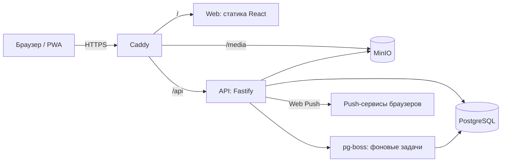
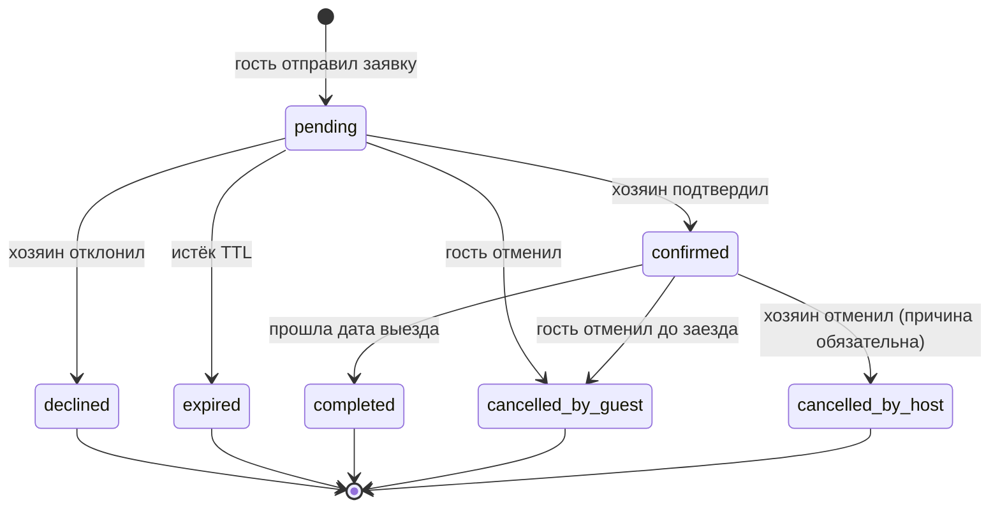

# ТЗ: StayNest — платформа аренды домов (PWA)

## 1. Цель
Показать в портфолио законченный сложнофункциональный продукт: два режима пользователя, календарь с защитой от двойного бронирования, поиск по свободным датам, загрузка фото, уведомления, PWA с офлайном, развёртывание на собственном VPS. Каждая важная техническая задача должна быть документирована (схема, диаграмма, тест, измерение).

## 2. Пользователи и режимы
Один аккаунт, два режима, переключатель в интерфейсе ("Я ищу" / "Я сдаю"). Отдельных ролей в БД нет: режим определяется тем, что пользователь делает.
- **Гость** (ищет и бронирует): каталог, фильтры, карточка дома, календарь, заявка на бронь, "Мои поездки", избранное.
- **Хозяин** (сдаёт): мастер создания объявления, фото, цены и сезонные правила, блокировка дат, входящие заявки, подтверждение и отклонение, календарь занятости.
- **Аноним**: может смотреть каталог и карточки, для брони и объявлений нужен вход.

## 3. Объём MVP
**Входит:** регистрация и вход, объявления (черновик, публикация, архив), фото, цены (базовая, выходные, сезонные), блокировки дат, каталог с фильтрами и сортировкой, поиск по свободным датам, расчёт стоимости на сервере, бронирование по заявке (хозяин подтверждает), статусы, отмена, истечение заявки, избранное, уведомления (внутренние, SSE, web push), PWA (установка, офлайн-режим для просмотра), ru/en, деплой на VPS.

**Не входит в MVP:** реальные платежи (только заглушка в Сессии 18), чаты, отзывы (таблица описана, реализация v2), интерактивная карта (в карточке только координаты и ссылка на внешнюю карту), мгновенное бронирование без подтверждения, возвраты денег, админ-панель.

**Опционально (Сессии 18–19):** платёжная заглушка с депозитом и webhook, оболочка Telegram Mini App.

## 4. Архитектура

Фронтенд собирается в статику и раздаётся Caddy. API отдельный контейнер. Фоновые задачи (истечение заявок, завершение броней, очистка) работают на pg-boss внутри процесса воркера, Redis не нужен.

## 5. Функциональные требования

### 5.1 Аккаунт
- FR-A1: регистрация по email и паролю (минимум 8 символов), имя обязательно.
- FR-A2: вход, выход, обновление сессии (refresh с ротацией), смена имени, телефона, аватара, языка.
- FR-A3: пароли только argon2id. Ограничение частоты попыток входа (rate limit).

### 5.2 Объявления (хозяин)
- FR-L1: мастер из 5 шагов: основное, расположение, характеристики и удобства, фото, цены и правила. Автосохранение черновика на каждом шаге.
- FR-L2: поля объявления описаны в `DB.md` (таблица `listings`). Публикация доступна, если заполнены название, описание (не менее 50 символов), город, адрес, вместимость, минимум 3 фото, базовая цена.
- FR-L3: управление фото: загрузка нескольких файлов, сжатие на клиенте до 2000 px по длинной стороне, проверка типа и размера (до 10 МБ исходник), превью, перетаскивание для сортировки, выбор обложки, удаление.
- FR-L4: цены: базовая цена за ночь, цена выходных (ночи с пятницы на субботу и с субботы на воскресенье), сезонные правила (период, цена, приоритет, опционально минимальный срок), уборка (разовая), минимальный и максимальный срок.
- FR-L5: блокировка дат хозяином (ремонт, личное использование).
- FR-L6: статусы объявления: `draft`, `published`, `archived`. Архивирование невозможно при активных будущих бронях.
- FR-L7: "Мои объявления": список со статусом, обложкой, числом входящих заявок.

### 5.3 Каталог и поиск (гость)
- FR-S1: список опубликованных объявлений с курсорной пагинацией (бесконечная прокрутка или кнопка "Показать ещё").
- FR-S2: фильтры: город (подсказки), даты заезда и выезда (только свободные дома), число гостей, диапазон цены за ночь, минимум спален, тип жилья (мультивыбор), удобства (мультивыбор, дом должен иметь все выбранные), текстовый поиск `q`.
- FR-S3: сортировка: по релевантности (при `q`), цене по возрастанию и убыванию, новизне, рейтингу (когда будут отзывы, пока скрыта).
- FR-S4: состояние фильтров и сортировки хранится в URL, ссылка воспроизводит выдачу.
- FR-S5: при выбранных датах в карточке списка показывается итоговая стоимость за период, а не только цена за ночь.
- FR-S6: карточка дома: галерея (свайп, клавиатура), описание, удобства, правила, календарь, блок брони со стоимостью.

### 5.4 Календарь
- FR-C1: выбор диапазона дат. Занятые и заблокированные ночи недоступны, прошлые даты недоступны.
- FR-C2: учитывается минимальный и максимальный срок. Нельзя выбрать диапазон, пересекающий занятые ночи.
- FR-C3: день выезда может совпадать с днём заезда следующего гостя (модель `[)`).
- FR-C4: при выборе дат мгновенно показывается расчёт (запрос к `/quote`): ночи, цена по ночам с группировкой, уборка, итог.
- FR-C5: у хозяина календарь занятости с цветовой легендой (заявка, подтверждено, блок), возможность добавить и снять блок.

### 5.5 Бронирование
- FR-B1: гость отправляет заявку (даты, число гостей, сообщение хозяину). Дома, где даты свободны, получают статус брони `pending`, даты сразу резервируются на время ожидания.
- FR-B2: хозяин подтверждает или отклоняет в течение TTL (по умолчанию 24 часа). Иначе заявка переходит в `expired` и даты освобождаются.
- FR-B3: гость и хозяин могут отменить. Правила в разделе 6.
- FR-B4: после даты выезда подтверждённая бронь автоматически становится `completed`.
- FR-B5: двойное бронирование невозможно даже при одновременных запросах. Ответ при конфликте: 409 с кодом `booking_dates_unavailable`.
- FR-B6: повторная отправка запроса с тем же `Idempotency-Key` не создаёт вторую бронь.
- FR-B7: все смены статуса пишутся в `booking_events` (аудит).

### 5.6 Уведомления
- FR-N1: внутренние уведомления (колокольчик, счётчик непрочитанных, список).
- FR-N2: обновление в реальном времени через SSE.
- FR-N3: web push при событиях: новая заявка (хозяину), подтверждение и отклонение (гостю), отмена (второй стороне), скорое истечение заявки (хозяину, за 3 часа).
- FR-N4: пользователь может включить и выключить push в профиле. Запрос разрешения только по клику, не на старте.

### 5.7 Избранное
- FR-F1: добавить и убрать дом из избранного, список избранного (работает офлайн из кэша).

### 5.8 PWA
- FR-P1: manifest, иконки (включая maskable), установка на домашний экран, кастомная кнопка "Установить".
- FR-P2: service worker (Workbox): precache оболочки, стратегии для API и картинок (раздел 8), офлайн-страница, индикатор "нет сети".
- FR-P3: офлайн доступны: последние просмотренные карточки, избранное, мои поездки (чтение). Действия, требующие сети, понятно блокируются.
- FR-P4: обновление приложения: баннер "Доступна новая версия" с кнопкой обновления.
- FR-P5: Lighthouse (мобильный профиль): Performance ≥ 85, Accessibility ≥ 95, Best Practices ≥ 95, SEO ≥ 90, PWA-проверки пройдены.

## 6. Бизнес-правила бронирования

**Модель дат.** Бронь хранится как `daterange` с границами `[)`: `[check_in, check_out)`. Число ночей = `check_out - check_in`. Бронь 10–12 июля занимает ночи 10 и 11, ночь 12 свободна.

**Валидация заявки (сервер):**
1. `check_in` не раньше сегодняшней даты (по таймзоне объявления, в MVP Europe/Moscow через переменную окружения).
2. Ночей не меньше `min_nights` и не больше `max_nights` (учитывая `min_nights` сезонного правила, берётся максимальное из применимых).
3. `guests_count` не больше `max_guests`.
4. Гость не равен хозяину объявления. Объявление опубликовано.
5. Диапазон не пересекается с блокировками и активными бронями.

**Статусы:** `pending`, `confirmed`, `declined`, `cancelled_by_guest`, `cancelled_by_host`, `expired`, `completed`.

Активные статусы (занимают даты): `pending`, `confirmed`. Остальные освобождают даты.

**Расчёт цены за ночь** (для каждой ночи диапазона):
1. Если есть сезонное правило, покрывающее ночь, берётся цена правила с наибольшим `priority`.
2. Иначе, если ночь выходного (пятница или суббота) и задана `weekend_price_minor`, берётся она.
3. Иначе `base_price_minor`.
Итог = сумма по ночам + `cleaning_fee_minor`. Сервисный сбор в MVP равен 0, но присутствует в `price_breakdown` для расширения. Разбивка сохраняется в `bookings.price_breakdown` (jsonb) и не пересчитывается задним числом.

**Отмена:** гость отменяет бесплатно в любой момент до заезда (политики возврата в MVP нет). Хозяин отменяет подтверждённую бронь только с причиной. Отмена заявки в `pending` без ограничений.

## 7. API (префикс `/api/v1`)

Формат ошибок: `application/problem+json` (`type`, `title`, `status`, `detail`, `code`, `errors[]` для валидации).

**Служебные**
- `GET /health`: статус API и БД

**Аккаунт**
- `POST /auth/register`, `POST /auth/login`, `POST /auth/refresh`, `POST /auth/logout`
- `GET /me`, `PATCH /me`

**Справочники**
- `GET /amenities`

**Каталог (публичные)**
- `GET /listings`: параметры `q, city, check_in, check_out, guests, price_min, price_max, bedrooms_min, type[], amenities[], sort, cursor, limit`
- `GET /listings/:id`
- `GET /listings/:id/calendar?from=YYYY-MM-DD&to=YYYY-MM-DD`: занятые ночи (без раскрытия, кто бронировал)
- `GET /listings/:id/quote?check_in&check_out&guests`: расчёт стоимости и проверка правил

**Объявления (хозяин)**
- `GET /me/listings`
- `POST /listings` (создаёт черновик), `PATCH /listings/:id`, `POST /listings/:id/publish`, `POST /listings/:id/archive`, `DELETE /listings/:id` (только черновик)
- `PUT /listings/:id/amenities`
- `POST /listings/:id/photos` (multipart), `PATCH /listings/:id/photos/order`, `PATCH /listings/:id/photos/:photoId/cover`, `DELETE /listings/:id/photos/:photoId`
- `GET|POST /listings/:id/price-rules`, `PATCH|DELETE /listings/:id/price-rules/:ruleId`
- `GET|POST /listings/:id/blocks`, `DELETE /listings/:id/blocks/:blockId`
- `GET /listings/:id/calendar/host`: занятость с деталями для хозяина

**Бронирования**
- `POST /bookings` (заголовок `Idempotency-Key` обязателен)
- `GET /me/bookings?role=guest|host&status=...&cursor`
- `GET /bookings/:id`
- `POST /bookings/:id/confirm`, `POST /bookings/:id/decline`, `POST /bookings/:id/cancel`

**Избранное**
- `GET /me/favorites`, `PUT /me/favorites/:listingId`, `DELETE /me/favorites/:listingId`

**Уведомления**
- `GET /me/notifications`, `POST /me/notifications/read`
- `GET /me/events` (SSE)
- `POST /me/push-subscriptions`, `DELETE /me/push-subscriptions`

## 8. Стратегии кэширования (service worker)
| Ресурс | Стратегия |
|---|---|
| Оболочка приложения (JS, CSS, HTML) | Precache, обновление через баннер |
| `GET /api/v1/listings` и карточки | StaleWhileRevalidate, TTL 10 минут |
| Фото (`/media/*`) | CacheFirst, лимит записей и срок хранения |
| `GET /me/bookings`, `/me/favorites` | NetworkFirst с фолбэком на кэш |
| `GET /quote`, `/calendar` | NetworkOnly (данные не должны быть устаревшими) |
| Любые `POST/PATCH/DELETE` | NetworkOnly, при отсутствии сети понятное сообщение |

## 9. Нефункциональные требования
- **Производительность:** выдача каталога при 10 000 объявлений и 100 000 броней: p95 меньше 150 мс на сервере (замеры в `docs/perf/`). Поиск по датам обязан использовать индекс (приложить `EXPLAIN ANALYZE`).
- **Конкурентность:** тест 50 параллельных заявок на одни даты: ровно одна успешная, остальные 409.
- **Безопасность:** argon2id, httpOnly cookie, CORS по whitelist, helmet-заголовки, rate limit, проверка MIME по содержимому файла, защита от IDOR (проверка владения), параметризованные запросы, лимиты размера тела.
- **Надёжность:** health-check, graceful shutdown, ежедневный бэкап БД и восстановление из бэкапа проверено руками.
- **Наблюдаемость:** структурные логи, request-id, метрики `/metrics` (опционально для Grafana на VPS).
- **Доступность:** WCAG AA, календарь управляется клавиатурой.
- **Локализация:** ru и en, форматирование дат и валюты через `Intl`.
- **Качество кода:** strict TypeScript, ESLint, Prettier, CI (lint, typecheck, test, build) на каждый push.

## 10. Окружения
- **dev:** `docker compose -f infra/docker-compose.dev.yml up` поднимает Postgres и MinIO; API и web запускаются локально. В текущем окружении Postgres вынесен на VPS и доступен через SSH-туннель (ADR-027), локальный compose остаётся альтернативой.
- **prod:** `infra/docker-compose.prod.yml`: caddy, api, worker (тот же образ api с другой командой), postgres, minio. Домен и TLS через Caddy. Переменные из `.env` на сервере.
- **Миграции:** применяются отдельной командой при деплое, не при старте API.

## 11. Демо-данные
- Скрипт `scripts/seed-demo`: 12–15 качественных объявлений в 3–4 городах (реальные фото с лицензией, описания на русском и английском), 2 демо-пользователя (хозяин и гость, пароли в README), несколько броней в разных статусах.
- Скрипт `scripts/seed-perf`: 10 000 объявлений и 100 000 броней для замеров.

## 12. Критерии готовности кейса (что увидит работодатель)
1. Живая демо-ссылка и два демо-аккаунта.
2. Репозиторий с понятным README, диаграммами (архитектура, ER-схема, статусы брони), ADR.
3. Тест конкурентной брони и описание exclusion constraint.
4. `EXPLAIN ANALYZE` и результаты нагрузочного замера.
5. Отчёт Lighthouse, установленное PWA, работа офлайн.
6. Видео 60–90 секунд: хозяин создаёт дом, гость бронирует, хозяин подтверждает, приходит push.
7. Страница кейса: задача, решения, проблемы и как решены, результаты, стек.
