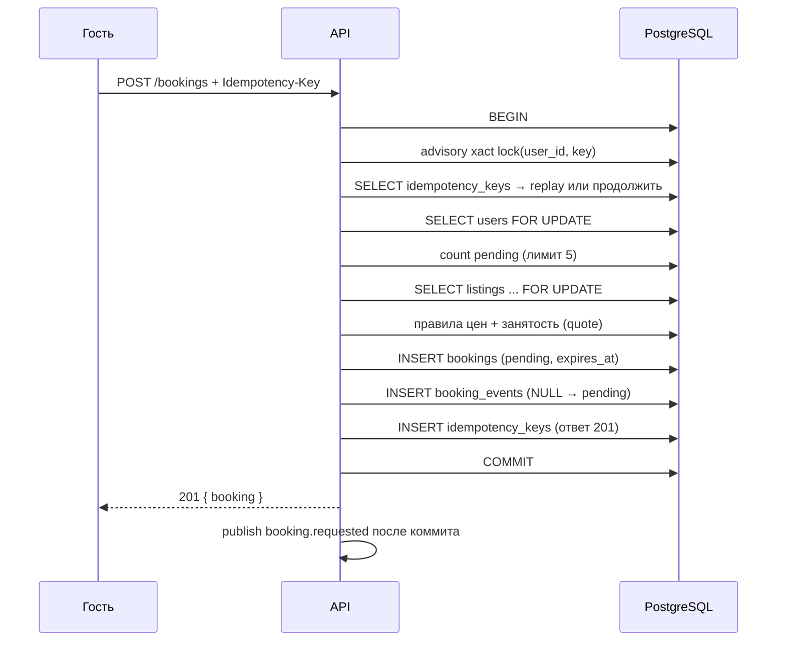
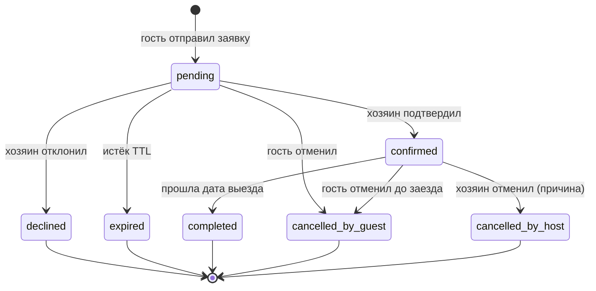

# Движок бронирования StayNest

Сессия 11. Документ описывает, как заявка проходит от `POST /bookings` до
подтверждения, отмены или автоматического завершения, и почему двойная бронь
невозможна даже при одновременных запросах.

## 1. Схема данных

```
users ─┐
       ├─ bookings (guest_id) ── booking_events
listing┘        │
                └─ stay_range daterange [check_in, check_out)
                   EXCLUDE USING gist (listing_id WITH =, stay_range WITH &&)
                   WHERE status IN ('pending', 'confirmed')
```

- `stay_range` — `[check_in, check_out)`: ночь выезда не занята. PostgreSQL
  канонизирует дискретный `daterange` к `[)`, поэтому `'[]'` и `'(]'` при
  вставке сдвигают границы, а не создают «неправильную» форму.
- `bookings_no_overlap` — exclusion constraint по `listing_id` и `stay_range`
  только для активных статусов. Это последняя линия защиты от двойной брони.
- `listing_blocks` живёт отдельно, поэтому пересечение с блокировкой хозяина
  проверяется в той же транзакции после `SELECT ... FOR UPDATE` объявления.
- `booking_events` — аудит: кто, из какого статуса, в какой и когда.
- `idempotency_keys` — сохранённый ответ на `Idempotency-Key`.

Миграция `0009_booking_engine` добавляет конечные границы диапазонов
(`NOT lower_inf AND NOT upper_inf`), индекс `(guest_id) WHERE status='pending'`
и строгий порядок событий `(booking_id, id)`. Таймлайн читается по `id`
(identity), а не по `created_at`: `now()` фиксируется на старте транзакции,
поэтому при конкурентных confirm/cancel время события может идти не по
порядку вставки.

## 2. Создание заявки



Порядок блокировок: `users → listings → bookings`. Он совпадает с
`availability` (создание блокировки дат) и `listings` (публикация/архив).
`pricing` не блокирует объявление при правке правил, но quote читает правила
внутри транзакции брони, поэтому цена фиксируется на момент вставки. Дедлоки
между этими путями маловероятны.

### Почему этого достаточно

1. Строка объявления блокируется на всю транзакцию. Второй запрос ждёт коммита
   первого и видит либо занятость в quote, либо нарушение exclusion constraint.
2. Exclusion constraint не зависит от кода приложения: даже прямой SQL не
   создаст пересекающиеся `pending`/`confirmed`.
3. Ошибка `23P01` превращается в `409 booking_dates_unavailable`.
4. Если worker отстал, `pending` с истёкшим `expires_at` не занимает даты:
   календарь, quote и каталог фильтруют такие строки, а создание брони под
   блокировкой объявления сначала переводит их в `expired` (с событием), и
   только потом считает quote и вставляет новую бронь.

## 3. Идемпотентность

- `Idempotency-Key` обязателен, 8–200 символов `[A-Za-z0-9._:-]`.
- Хэш: SHA-256 от `POST /bookings` + нормализованного тела (ключи отсортированы).
- `pg_advisory_xact_lock(hashtextextended(user_id || ':' || key, 0))`
  сериализует одинаковые ключи. Без него два параллельных запроса оба увидели
  бы «ключа ещё нет».
- Повтор с тем же телом возвращает сохранённые `status` и `body`, заголовок
  `Idempotency-Replayed: true`. Повтор не расходует rate limit: проверка ключа
  стоит до счётчика.
- Другое тело с тем же ключом → `422 idempotency_key_conflict`.
- Ошибки (409/422) не сохраняются: повтор после освобождения дат должен иметь
  шанс выполниться. Это осознанно отличается от «хранить любой ответ» и
  описано в ADR-063.
- Ключи старше 48 часов удаляются джобом.

## 4. Статусы и переходы



`modules/bookings/state-machine.ts` — таблица `action × status × role`.
Обновление статуса идёт под `SELECT ... FOR UPDATE` брони, поэтому две
команды не могут примениться к одному и тому же исходному статусу.

Правила:

- `confirm`/`decline` — только хозяин объявления; гость получает `403`.
- Если `pending` уже истёк (`expires_at <= now()`), любое действие сначала
  переводит его в `expired` под той же блокировкой и отвечает
  `409 invalid_booking_transition`. Джоб не обязан успеть раньше.
- `cancel` из `pending` — только гость.
- `cancel` из `confirmed` — гость (до даты заезда) или хозяин с причиной.
- Чужая бронь неотличима от несуществующей (`404 booking_not_found`).
- Запрещённый переход — `409 invalid_booking_transition`.

## 5. Фоновые задачи (pg-boss)

Worker — отдельный процесс `dist/worker.js`; API задачи не запускает.
Схема `pgboss` создаётся самим pg-boss при старте.

| Задача | Cron | Действие |
|---|---|---|
| `bookings.expire-pending` | `* * * * *` | `pending` с `expires_at <= now()` → `expired` |
| `bookings.complete-past` | `15 0 * * *` (таймзона объявлений) | `confirmed` с `check_out < today` → `completed` |
| `bookings.cleanup-idempotency` | `30 3 * * *` | удалить `idempotency_keys` старше 48 часов |

Джобы выбирают строки `FOR UPDATE SKIP LOCKED` и обрабатывают до 100 за
проход, повторяя пачки (до 10 за запуск), чтобы не отставать после простоя.
Поэтому confirm, decline и истечение не могут одновременно изменить одну
бронь: проигравший видит новый статус и получает `409`. Каждое изменение
пишет `booking_events` и публикует событие после коммита.

## 6. Лимиты и защита от спама

- `BOOKING_MAX_ACTIVE_PENDING` (5) — считается в БД под блокировкой `users`,
  поэтому точен и между инстансами API.
- `BOOKING_RATE_LIMIT_MAX` / `BOOKING_RATE_LIMIT_WINDOW_MINUTES` — fixed window
  в памяти процесса (как auth, ADR-034).
- `REQUIRE_EMAIL_VERIFICATION=true` требует подтверждённый email.
- Своё объявление бронировать нельзя.

## 7. Коды ошибок

| Код | HTTP | Когда |
|---|---|---|
| `booking_dates_unavailable` | 409 | даты заняты или пересекают блокировку |
| `invalid_booking_transition` | 409 | действие запрещено из текущего статуса |
| `booking_not_found` | 404 | нет брони или пользователь не участник |
| `booking_action_forbidden` | 403 | гость пытается подтвердить/отклонить |
| `booking_own_listing` | 422 | гость — владелец объявления |
| `email_not_verified` | 403 | флаг включён, email не подтверждён |
| `cancellation_window_closed` | 422 | гость отменяет после заезда |
| `host_cancel_reason_required` | 422 | хозяин отменяет без причины |
| `too_many_pending_bookings` | 429 | больше 5 активных заявок |
| `booking_rate_limited` | 429 | превышен rate limit |
| `idempotency_key_required` | 400 | нет заголовка |
| `invalid_idempotency_key` | 422 | ключ неверного формата |
| `idempotency_key_conflict` | 422 | тот же ключ, другое тело |

## 8. Проверки

- `state-machine.test.ts` — 42 комбинации.
- `tests/bookings-create.test.ts` — создание, идемпотентность, конфликты,
  лимиты, email, свои объявления.
- `tests/bookings-actions.test.ts` — переходы, права, гонки confirm/decline и
  confirm/cancel, пагинация и таймлайн.
- `tests/bookings-jobs.test.ts` — истечение, завершение, очистка ключей.
- `tests/booking-concurrency.test.ts` — 50 одновременных заявок на одни даты,
  20 запусков подряд; каждый раз ровно 1 × 201 и 49 × 409
  `booking_dates_unavailable`.
- `tests/security/idor.test.ts` — матрица IDOR расширена действиями с бронью.

Запуск:

```bash
pnpm --filter @staynest/api test bookings
pnpm --filter @staynest/api test booking-concurrency
```

## 9. Ограничения и следующий шаг

- UI бронирования, «Мои поездки» и входящие заявки — Сессия 12.
- Уведомления о событиях `booking.*` — Сессия 13 (сейчас события уже
  публикуются в event bus).
- Rate limit в памяти процесса: при нескольких инстансах переносится в общее
  хранилище (Backlog).
- `expires_at` хранится в `timestamptz`; TTL считается от серверного времени,
  а не от часов браузера.
