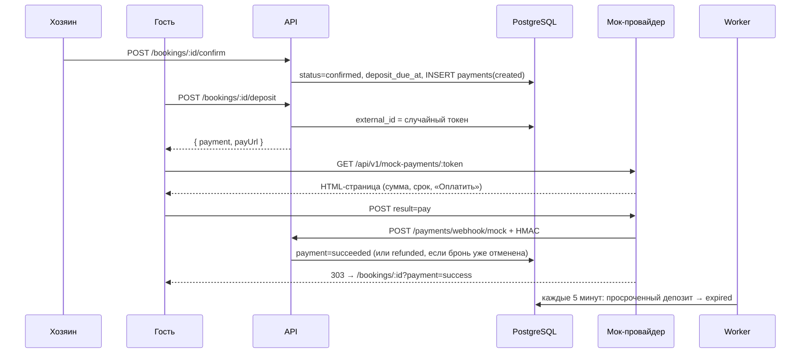

# Депозит и платежи (Сессия 18)

Демонстрационный платёжный поток без реальных денег. Задача — показать, как
устроен депозит после подтверждения брони, как принимается вебхук провайдера и
как заменить мок на ЮKassa или Stripe, не меняя модель данных.

## 1. Правила

- Хозяин подтверждает заявку → бронь переходит в `confirmed`, даты заняты, в
  `bookings.deposit_due_at` записывается срок оплаты, создаётся строка
  `payments` (`kind='deposit'`, `status='created'`).
- Депозит — процент от `bookings.total_minor` (`PAYMENT_DEPOSIT_PERCENT`, по
  умолчанию 20%), деньги в копейках, округление вверх. Сумму считает только
  сервер.
- Гость открывает сессию оплаты (`POST /bookings/:id/deposit`) и уходит на
  hosted-страницу провайдера. Повторный запрос возвращает ту же сессию, пока
  она открыта.
- Провайдер присылает вебхук с HMAC-подписью. Успех переводит платёж в
  `succeeded`; бронь остаётся `confirmed`.
- Если депозит не оплачен до `deposit_due_at`, джоб переводит бронь в
  `expired`, открытые платежи — в `failed`, даты освобождаются, гость и хозяин
  получают уведомление `booking_deposit_expired`.
- Отмена оплаченной брони (гость до заезда или хозяин с причиной) переводит
  депозит в `refunded`; открытые сессии отменённой брони закрываются как
  `failed`, а поздний успешный вебхук фиксируется возвратом. В мок-провайдере
  возврат мгновенный.
- Карточные данные не запрашиваются и не хранятся: на странице оплаты нет
  полей карты, strict-схема вебхука отвергает лишние поля, в `raw_event`
  попадает только проверенное событие.

Статус брони не расширяется новым значением: состояние платежа живёт в
`payments`, а неоплата — это истечение срока брони (`expired` с событием
`deposit_due_at`). Так exclusion constraint и машина состояний не меняются.

## 2. Поток



## 3. API

| Метод | Путь | Права | Ответ |
|---|---|---|---|
| `POST` | `/api/v1/bookings/:id/deposit` | гость брони | `{ payment, payUrl }` |
| `GET` | `/api/v1/mock-payments/:token` | публично по токену | HTML-страница мок-провайдера |
| `POST` | `/api/v1/mock-payments/:token` | публично по токену | `303` назад на бронь |
| `POST` | `/api/v1/payments/webhook/mock` | HMAC-подпись | `{ received: true, replayed: boolean }` |

`GET /bookings/:id` отдаёт блок `deposit`: `status`, `amountMinor`, `currency`,
`dueAt`, `paidAt`, `refundedAt`. Ссылка на оплату в детали не хранится — она
создаётся по кнопке, чтобы токен не жил в кэше страницы бесконечно.

Ошибки:

| Код | HTTP | Когда |
|---|---|---|
| `payment_forbidden` | 403 | платит не гость брони |
| `payment_not_found` | 404 | нет платежа/сессии |
| `deposit_unavailable` | 409 | бронь не подтверждена или депозит выключен |
| `deposit_already_paid` | 409 | депозит уже оплачен/возвращён |
| `deposit_expired` | 409 | срок оплаты истёк |
| `payment_signature_invalid` | 401 | подпись не совпала |
| `payment_payload_invalid` | 400 | тело не по схеме (включая карточные поля) |
| `payment_webhook_conflict` | 409 | для `external_id` уже обработано другое событие |

## 4. Вебхук и идемпотентность

Тело:

```json
{
  "externalId": "случайный-токен-сессии",
  "status": "succeeded",
  "amountMinor": 330000,
  "currency": "RUB",
  "occurredAt": "2026-10-20T12:00:00.000Z"
}
```

Подпись: `HMAC-SHA256(PAYMENT_WEBHOOK_SECRET, rawBody)` в заголовке
`x-mock-signature`, hex. Проверяется по сырому телу через `timingSafeEqual`, а
не по пересобранному JSON. Вебхук исключён из origin-guard: он защищён
подписью, а Origin у провайдера свой.

Идемпотентность:

- ключ — `(provider, external_id)`, на нём уникальный индекс;
- повтор того же события возвращает `200 { received: true, replayed: true }`;
- событие с другим статусом/суммой для того же `external_id` → `409`;
- при повторе после возврата (`refunded`) успешное событие считается уже
  применённым.

Порядок блокировок в вебхуке: `bookings → payments`. Джоб просрочки блокирует
те же строки в том же порядке, поэтому дедлока нет. Если вебхук приходит после
отмены, платёж сразу помечается `refunded` — в отменённой брони не остаётся
«оплачено».

## 5. Гонка оплаты и отмены

Обе операции сериализуются на строке брони (`SELECT ... FOR UPDATE`):

- отмена успела первой → открытые сессии закрываются (`failed`), а поздний
  успешный вебхук переводит платёж в `refunded`;
- оплата успела первой → отмена видит `succeeded` и тоже ставит `refunded`.

Инвариант: после обеих операций платёж `refunded`, бронь отменена. Тест
`tests/payments.test.ts` запускает обе операции параллельно.

## 6. Замена мока на реального провайдера

Слой провайдера — `modules/bookings/payments/provider.ts` и `service.ts`.
Чтобы подключить ЮKassa или Stripe:

1. Создание платежа: вместо `createMockSessionId()` вызвать API провайдера
   (`POST /payments` у ЮKassa, `PaymentIntent` у Stripe) и сохранить его
   идентификатор в `payments.external_id`, а URL hosted-страницы вернуть
   клиенту. Сумма и валюта уже лежат в `payments`.
2. Вебхук: отдельный маршрут на провайдера, проверка подписи официальной
   библиотекой/документированным способом (у ЮKassa — IP + HMAC, у Stripe —
   `Stripe-Signature`). Дальше вызывается тот же `handleWebhook`.
3. Статусы: маппинг статусов провайдера в `created/succeeded/failed/refunded`.
4. Возвраты: вместо мгновенного `refunded` вызвать refund API и обновить
   строку после вебхука `refund.succeeded`.
5. Секреты: `PAYMENT_WEBHOOK_SECRET` (или ключи провайдера) только в `.env` на
   сервере, не в git. В production API не стартует без секрета, если мок включён.

Почему карты не у нас: приём карты на своей странице требует PCI DSS. Hosted-
страница провайдера оставляет данные карты у него, нам приходит только
результат и идентификатор операции (SAQ-A). Поэтому в схеме нет полей card/pan/
cvv, а strict-схема вебхука отвергает такие поля.

## 7. Настройки

```env
PAYMENT_MOCK_ENABLED=true
PAYMENT_DEPOSIT_PERCENT=20
PAYMENT_DEPOSIT_TTL_HOURS=48
PAYMENT_WEBHOOK_SECRET=       # обязателен в production всегда
```

`PAYMENT_MOCK_ENABLED=false` отключает депозит: подтверждение не создаёт
платёж и не ставит срок, а публичные маршруты `/mock-payments/*` и
`/payments/webhook/mock` не регистрируются (иначе остался бы способ пометить
платёж оплаченным серверным секретом).

## 8. Фоновые задачи

| Задача | Cron | Действие |
|---|---|---|
| `payments.expire-deposits` | `*/5 * * * *` | `confirmed` с `deposit_due_at <= now()` и без успешного депозита → `expired`, открытые платежи → `failed` |

Джоб берёт до 100 строк за транзакцию (`FOR UPDATE SKIP LOCKED`) и повторяет
пачки до 10 раз. Событие `booking.deposit_expired` уходит в уведомления гостю и
хозяину.

## 9. Проверки

- `apps/api/tests/payments.test.ts` — создание депозита, сессия, права,
  валидный и повторный вебхук, неверная подпись, конфликт суммы, карточные
  поля, просрочка, гонка оплаты и отмены, HTML-страница без полей карты.
- `apps/web/src/features/booking/components/DepositPanel.test.tsx` — состояния
  депозита для гостя и хозяина.
- Ручная проверка: подтвердить заявку хозяином, открыть бронь гостем, нажать
  «Оплатить депозит», на странице мок-провайдера выбрать «Оплатить» и увидеть
  `?payment=success`.
